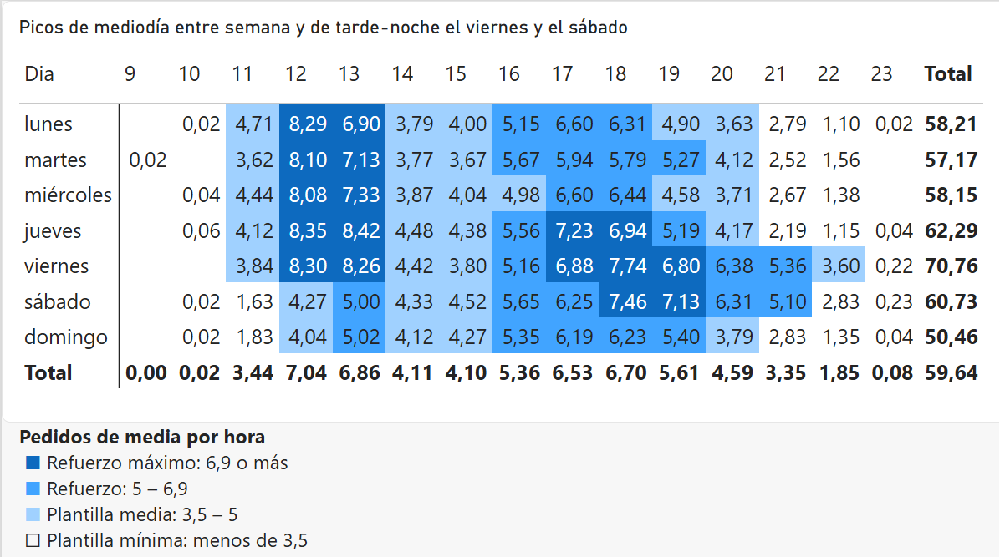
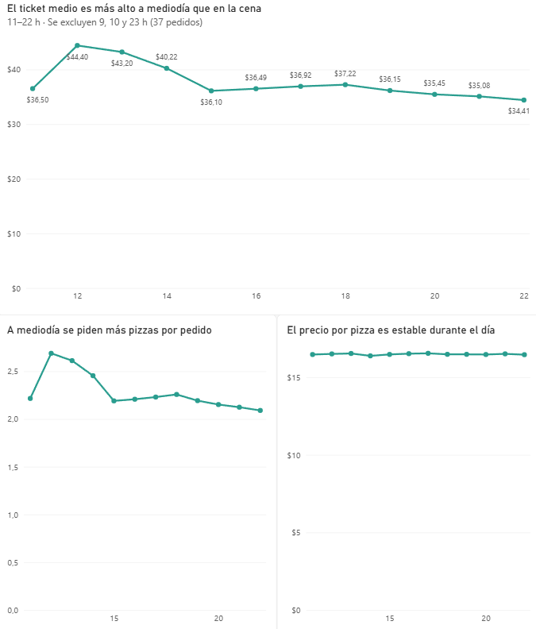
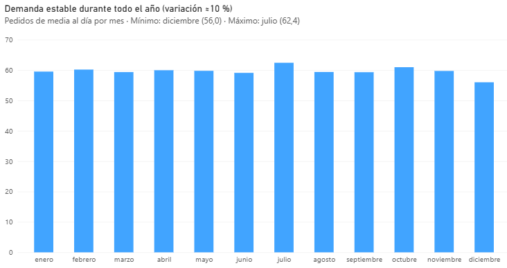

# Plato's Pizza – Análisis de ventas 2015

Análisis de un año de ventas de una pizzería (≈21.000 pedidos) desde la perspectiva
de un General Manager: decisiones de personal, carta, ticket medio y estacionalidad.

## Preguntas de negocio
1. ¿Cuándo se concentra la demanda y cómo ajustar los turnos de personal?
2. ¿Qué pizzas son estrellas y cuáles sobran en la carta?
3. ¿Cuál es el ticket medio y dónde hay margen de upselling?
4. ¿Hay estacionalidad que justifique acciones comerciales?

## Stack
SQL (BigQuery) · Power BI · GitHub

## Datos
[Maven Analytics – Pizza Place Sales](https://mavenanalytics.io/data-playground/pizza-place-sales)
4 tablas: orders, order_details, pizzas, pizza_types.

## Estado
🚧 En curso
- SQL: preguntas 1, 2 y 4 completadas · pregunta 3 en curso
- Pendiente: dashboard en Power BI

## Conclusiones

### 1. ¿Cuándo se concentra la demanda y cómo ajustar los turnos de personal?

* Horario operativo real: 11:00–23:00. Las 9, 10 y 23 h tienen pedidos residuales.
* Días con más pedidos: viernes (70,8 de media al día), jueves (62,3) y sábado (60,7). El domingo es el más flojo (50,5).
* Picos: de lunes a viernes hay dos, uno en comidas (12–14, más de 8 pedidos/hora a las 12) y otro por la tarde (17–19). El sábado y el domingo solo hay pico de tarde. El viernes y el sábado ese pico se alarga hasta las 21.
* Recomendación (detalle por franjas más abajo):
  * **Refuerzo máximo**: comidas de lunes a viernes, tardes del jueves (17–19) y tardes del viernes y el sábado (17–21).
  * **Refuerzo**: tardes de domingo a miércoles (17–19).
  * **Dotación mínima**: sábado y domingo antes de las 12, de domingo a jueves desde las 21 y sábado desde las 22.

#### Lo que añade la matriz día × hora (Power BI)

En SQL se analizaron el día y la hora por separado. Al cruzarlos en una matriz aparece un patrón que las medias no mostraban:

* El pico de comida (12–14) solo se da de lunes a viernes, con más de 8 pedidos/hora a las 12. El sábado y el domingo la comida baja a 4,0–5,0.
* De lunes a jueves, el pico de tarde se concentra entre las 17 y las 19, y la demanda cae desde las 19. El jueves a las 17 llega a 7,2.
* El viernes y el sábado, el pico de tarde alcanza su máximo a las 18 (7,7 y 7,5) y se mantiene alto hasta las 21.

**Hipótesis:** el pico de comidas de lunes a viernes se explicaría por clientela de oficinas de la zona; la tarde-noche larga de viernes y sábado, por grupos de familia y amigos que se reúnen para socializar.

**Limitación:** no se puede comprobar con este dataset, que no distingue entre sala, recogida y domicilio.

<b>Recomendación de turnos por franjas</b>

Pedidos de media por hora; las franjas incluyen la hora de inicio y terminan antes de la hora final (p. ej. 12–14 = de 12:00 a 13:59).

**Refuerzo máximo**

* Comidas de lunes a viernes, 12–14: la demanda más alta de la semana (8,1–8,4 a las 12; 6,9–8,4 a las 13).
* Viernes y sábado, 17–21: 6,3–7,7. No son los valores más altos, pero el pico dura cuatro horas.
* Jueves, 17–19: 7,2 y 6,9, al nivel del fin de semana pero más corto.

**Refuerzo**

* Domingo a miércoles, 17–19: 5,8–6,6.
* Todos los días a las 16: 5,0–5,7, para preparar el pico de tarde.
* Viernes y sábado a las 21: 5,1–5,4, la cola del pico de fin de semana.

**Plantilla media**

* Lunes a viernes a las 11: 3,6–4,7.
* Todos los días, 14–16: valle entre picos (3,7–4,5).
* Sábado y domingo, 12–14: 4,0–5,0. El fin de semana no hay pico de comida.
* Domingo a jueves, 19–21: 3,6–5,4.
* Viernes a las 22: 3,6.

**Plantilla mínima**

* Sábado y domingo a las 11: menos de 2.
* Domingo a jueves desde las 21, y sábado a las 22: menos de 3.
* Las 9, 10 y 23 h tienen pedidos residuales (menos de 0,25 de media); conviene valorar si compensa abrir en esas horas.

### 2. ¿Qué pizzas son estrellas y cuáles sobran en la carta?

> **Limitación:** el dataset no incluye costes, así que el análisis se basa en unidades vendidas e ingresos, no en margen.

#### Pizzas estrella
La venta está muy repartida: en unidades, ninguna pizza llega al 5 % del total.

**Top 5 por unidades:**
- classic_dlx: 2.453 (4,95 %)
- bbq_ckn: 2.432 (4,91 %)
- hawaiian: 2.422 (4,89 %)
- pepperoni: 2.418 (4,88 %)
- thai_ckn: 2.371 (4,78 %)

**Por ingresos**, lidera thai_ckn (5,31 %), seguida de bbq_ckn (5,23 %) y cali_ckn (5,01 %), que en unidades queda 6ª.

#### Candidatas a salir: mediterraneo y spinach_supr
Las 10 pizzas con menos ventas son las mismas tanto en unidades como en ingresos. Dentro de ese grupo, dos destacan en ambas métricas:
- **mediterraneo:** 2ª con menos unidades (1,88 %) y 4ª con menos ingresos (1,88 %).
- **spinach_supr:** 4ª con menos unidades (1,92 %) y 3ª con menos ingresos (1,87 %).

Además, son las **únicas dos pizzas que usan aceitunas kalamata**. Retirarlas juntas permitiría eliminar ese ingrediente de las compras; retirar solo una no generaría ese ahorro.

#### Caso especial: brie_carre
Es la última en unidades (0,99 %) y en ingresos (1,42 %), pero **solo se ofrece en talla S** y a 23,65 USD, casi el doble que el resto de pizzas S (9,75–12,75 USD). Aun así, **dentro de las pizzas S ocupa el 9º puesto en ventas**, por encima de la media de su talla.

**Recomendación:** mantenerla y probar a ofrecerla en talla M durante un periodo para medir el impacto en unidades e ingresos. Si tras 3 meses la Brie Carre (sumando S y M) no alcanza las 80 unidades al mes, el ritmo de venta del grupo más bajo, se retira de la carta.

### Hallazgo del dashboard: el precio dentro de cada grupo

En la dispersión, las pizzas forman cuatro grupos según las unidades vendidas. Dentro de cada grupo, las que ingresan menos son las más baratas: Green Garden, Pepperoni Mushroom and Peppers, Big Meat, Pepperoni y Hawaiian tienen un precio medio de 12–14 $, frente a 16–18 $ de sus vecinas. Venden lo mismo, pero cada unidad ingresa menos.
Excepción: la Big Meat no es barata por carta, sino porque solo se ha vendido en talla S, aunque M y L figuran en la carta. Sin datos de costes no se puede saber si estas pizzas son menos rentables.

### 3. ¿Cuál es el ticket medio y dónde hay margen de upselling?

El ticket medio global es de $38,3 y apenas varía entre días: hay una diferencia de alrededor del 3 % entre el día con menor ticket medio (domingo, $37,81) y el día con mayor ticket medio (sábado, $39,01).

Durante el día, el ticket medio llega a ser hasta un ~20 % más alto en las comidas (40–44 USD de 12:00 a 14:59) que en el resto del día, incluida la cena (~36,5 USD). Esto descartó mi hipótesis inicial de que el ticket medio sería más alto en las cenas, momento en el que familias y amigos se reúnen.

**Nota:** se excluyen las 9, 10 y 23 h (37 pedidos en total, menos del 0,2 %), porque con tan pocos pedidos el ticket medio no es representativo.

El siguiente paso fue averiguar por qué el ticket medio era más alto en las comidas. Las hipótesis eran dos: o se piden más pizzas por pedido, o se piden pizzas de mayor precio.

* **Precio por pizza:** estable a lo largo del día (en torno a $16,5).
* **Pizzas por pedido:** varía según el turno. En las comidas alcanza 2,69 pizzas por pedido a las 12 h y 2,45 a las 14 h; en el resto del día ronda las 2,2.

Por tanto, la diferencia de ticket se explica por el número de pizzas por pedido, no por el precio de las pizzas.

**Margen de upselling:** está en las cenas. Para aprovecharlo, habría que centrarse en aumentar el número de pizzas por pedido, ya que el precio por pizza es estable. Pasar de 2,2 a 2,4 pizzas por pedido elevaría el ticket medio de la cena en unos $3 (si se mantiene el precio medio por pizza).

### 4. ¿Hay estacionalidad que justifique acciones comerciales?

* **Demanda estable durante el año:** entre 56,0 pedidos/día (diciembre) y 62,4 (julio), una variación de ≈10 %.
* **Comparar totales mensuales lleva a error:** por total, septiembre parecía el mes más flojo, pero por sus días de cierre. En media diaria, el más flojo es diciembre.
* **Implicación:** no se justifican grandes campañas estacionales; la variación relevante está dentro de la semana y del día (ver conclusión 1).

